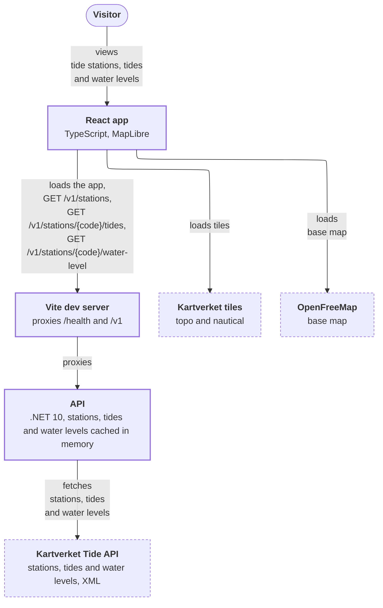
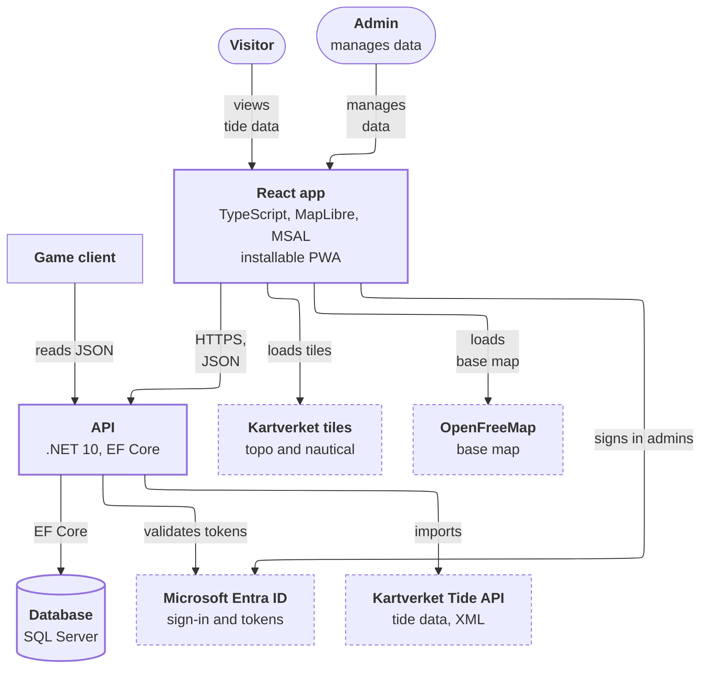

# Architecture

The system being built, shown as a context diagram and two container diagrams from the [C4 model](https://c4model.com/). One shows the containers that run today, and the other shows the containers planned once SQL Server and sign-in are added.

## Context

| Element | Role |
| --- | --- |
| Visitor | Anyone. Reads tide data without signing in. |
| Admin | Signs in with Entra ID and needs the `Admin` role to manage locations and imports. |
| Game client | Reads tide data through the public, versioned API. Holds no keys or secrets. |
| Tides | Imports tide data from Kartverket, stores it and serves it as JSON. |
| Kartverket Tide API | Source of tide data. Free, no key, licensed CC BY 4.0. |
| Kartverket map tiles | Topo map and nautical chart drawn over the base map, loaded directly by the browser. Free, no key. |
| OpenFreeMap | Base map under the Kartverket tiles, from OpenStreetMap data. Shows where Kartverket has no coverage or its tiles fail to load. Free, no key. |
| Microsoft Entra ID | Signs in admins and issues the tokens the API checks. |

## Containers today

| Container | Role |
| --- | --- |
| React app | Shows the map and Kartverket's tide stations as markers. Tapping a station opens a card with its latest measured water level and its high and low tides, in the browser's time zone. The tides start with today and tomorrow, and scrolling to either end of the strip loads the 7 days before or after. Loads map tiles directly and fetches stations, tides and water levels from the API. |
| Vite dev server | Serves the React app in development and proxies `/health` and `/v1` to the API, so the browser makes no cross-origin requests. |
| API | Serves the station list, each station's high and low tides and its latest measured water level as JSON. Fetches the station list from Kartverket on the first request and keeps it in memory for 24 hours. Fetches a station's tides on the first request for that station each UTC day and keeps them in memory for the rest of that day. Keeps a station's water level in memory for 5 minutes. |

## Containers planned

| Container | Role | Hosted on |
| --- | --- | --- |
| React app | Shows stations and tides on the map. Admins sign in with MSAL and send their changes to the API with an access token. | Azure Static Web Apps |
| API | Serves tide data as JSON. Checks the `Admin` role on every write and runs imports from Kartverket. | Azure Container Apps, image from GitHub Container Registry |
| Database | Stores locations, imports and the imported tide data. | SQL Server in Docker locally, Azure SQL in the cloud |
