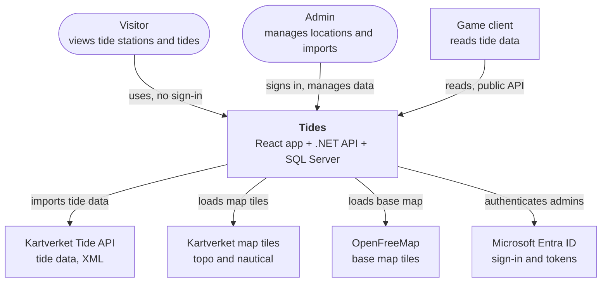
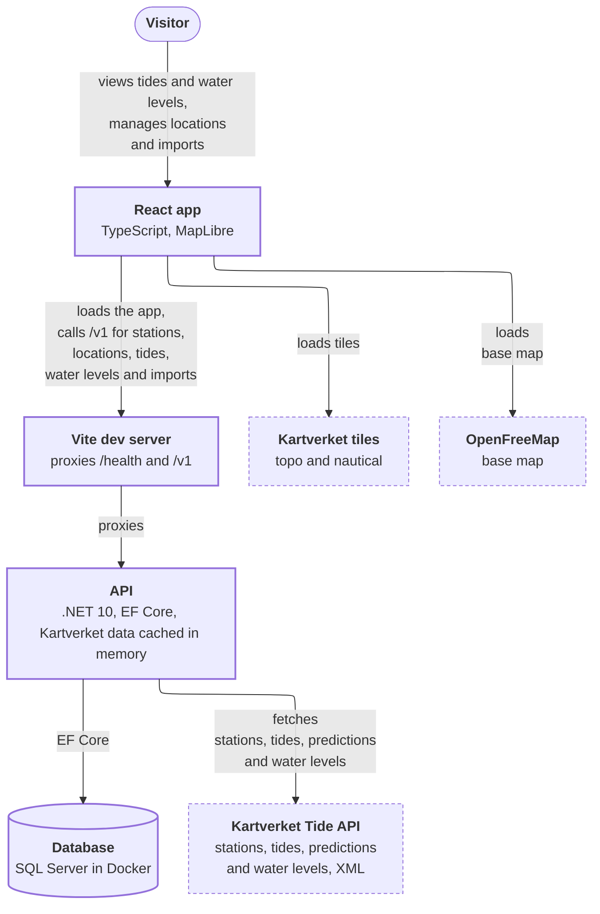
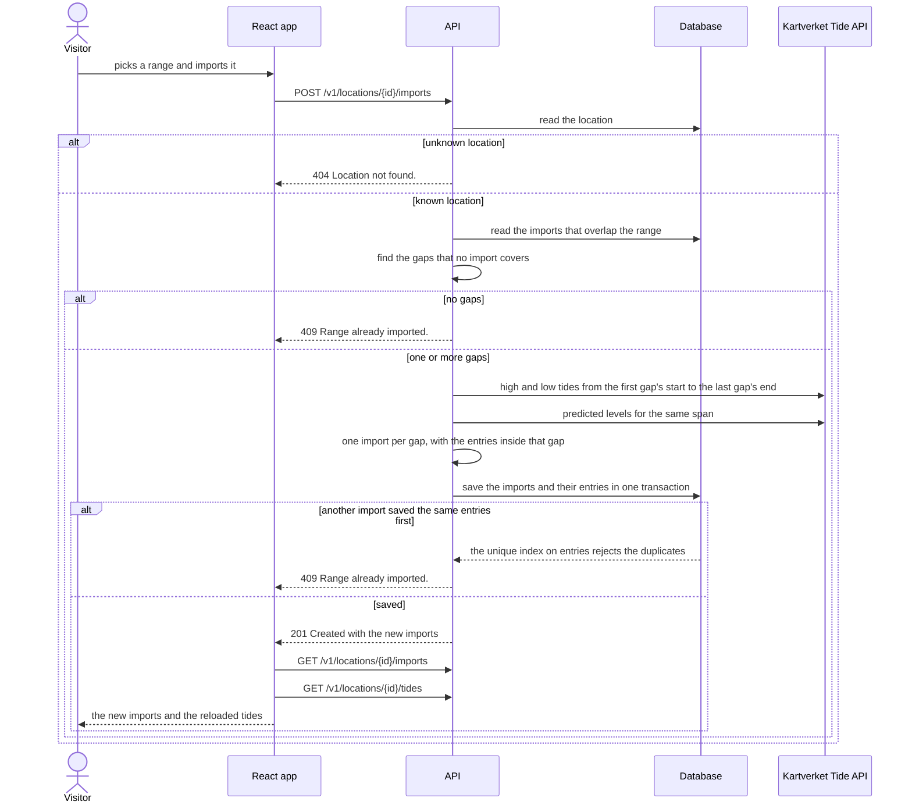

# Architecture

The system being built, shown as a context diagram and two container diagrams from the [C4 model](https://c4model.com/). One shows the containers that run today, and the other shows the containers planned once sign-in and deployment are added. A sequence diagram shows how an import runs.

## Context

| Element | Role |
| --- | --- |
| Visitor | Anyone. Reads tide data without signing in. |
| Admin | Signs in with Entra ID and needs the `Admin` role to manage locations and imports. |
| Game client | Reads tide data through the public, versioned API. Holds no keys or secrets. |
| Tides | Imports tide data from Kartverket, stores it and serves it as JSON. |
| Kartverket Tide API | Source of tide data. Free, no key, licensed CC BY 4.0. |
| Kartverket map tiles | Topo map and nautical chart drawn over the base map, loaded directly by the browser. Free, no key. |
| OpenFreeMap | Base map under the Kartverket tiles, from OpenStreetMap data. Shows where Kartverket has no coverage or its tiles fail to load. Free, no key. |
| Microsoft Entra ID | Signs in admins and issues the tokens the API checks. |

## Containers today

| Container | Role |
| --- | --- |
| React app | Shows the map with Kartverket's tide stations as round markers and saved locations as square markers. Tapping a marker opens a card with the water level and the high and low tides, in the browser's time zone. A station shows its latest measured level, and a location shows a level estimated from the nearest station. The tides start with today and tomorrow, and scrolling to either end of the strip loads the 7 days before or after. A long press on the map offers to add a location there, and the form saves the location with a first import for a chosen range preset. A location's card lists its imports, imports more ranges and deletes an import or the location. Loads map tiles directly, fetches stations, locations, tides, water levels and imports from the API, and sends location and import changes to it. |
| Vite dev server | Serves the React app in development and proxies `/health` and `/v1` to the API, so the browser makes no cross-origin requests. |
| API | Serves stations, locations, tides, water levels and imports as JSON, and saves and deletes locations and imports. Fetches the station list from Kartverket on the first request and keeps it in memory for 24 hours. Fetches the tides for a range on the first request and keeps them in memory for 24 hours, except for a location whose imports cover the range, which it reads from the database. Keeps a station's water level and a location's estimate in memory for 5 minutes. Imports a location's tides from Kartverket into the database. |
| Database | Stores locations, imports and the imported tide data, which holds the high and low tides and the predicted level every 10 minutes. Runs as the `mssql` service in Compose and keeps its data in the `mssql-data` volume. The `migrate` service applies the EF Core migrations before the API starts. |

## Import

An import stores a location's tides for a range in the database. The API imports only the parts of the range that no earlier import covers, and fetches all of them from Kartverket in one span.

Two imports for the same location that run at the same time can both find the same gap. The database keeps entries unique on location, time and type, so the second save fails and the API answers it as if the range was already imported.

## Containers planned

| Container | Role | Hosted on |
| --- | --- | --- |
| React app | Shows stations and tides on the map. Admins sign in with MSAL and send their changes to the API with an access token. | Azure Static Web Apps |
| API | Serves tide data as JSON. Checks the `Admin` role on every write and runs imports from Kartverket. | Azure Container Apps, image from GitHub Container Registry |
| Database | Stores locations, imports and the imported tide data. | SQL Server in Docker locally, Azure SQL in the cloud |
