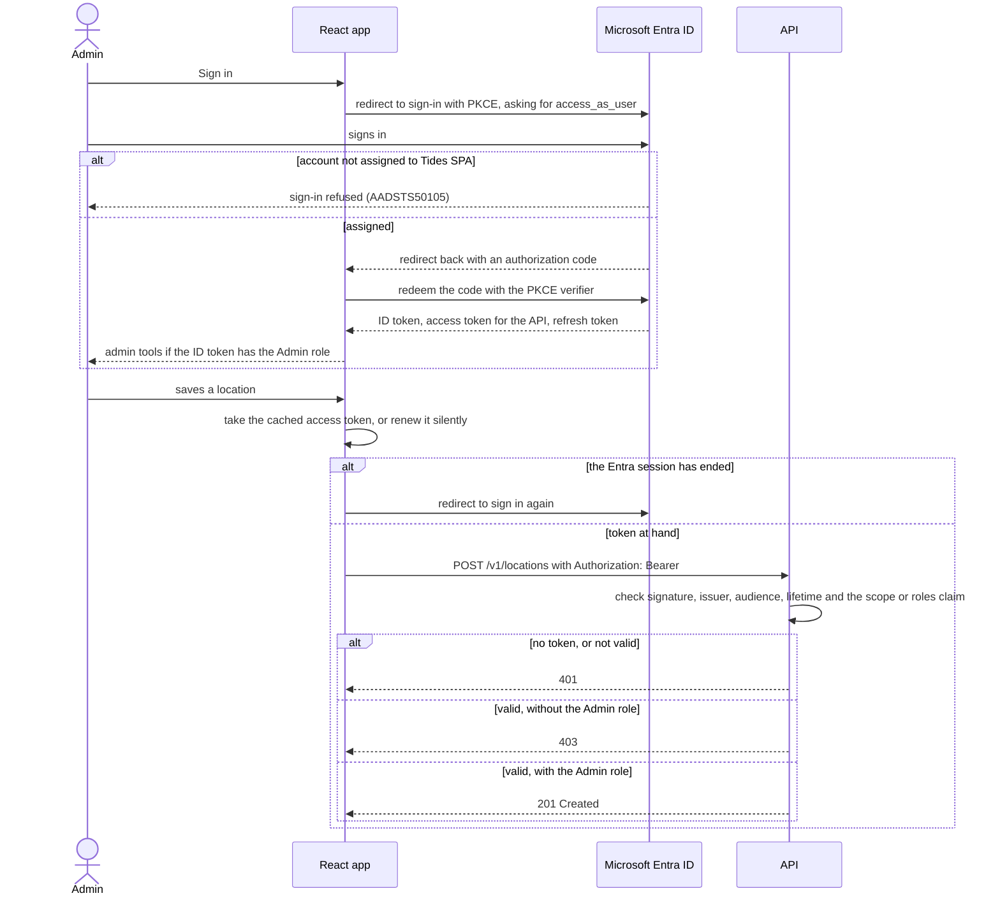

# Authentication

Reading tide data needs no sign-in. Saving and deleting locations and imports needs a Microsoft Entra ID access token with the `Admin` app role, as described under [Authentication](api.md#authentication) in api.md. Only the React app signs in. It uses MSAL React with the redirect flow, and the API validates the tokens with Microsoft.Identity.Web. No client secret exists anywhere.

## App registrations

Two app registrations in the Tides Entra tenant describe the two sides.

| Registration | Holds |
| --- | --- |
| Tides API | The Application ID URI `api://<API client ID>`, the delegated scope `access_as_user`, and the `Admin` app role. Access tokens for the API carry the role in their `roles` claim. |
| Tides SPA | The single-page application platform with the app's redirect URIs, the delegated permission to `access_as_user`, and its own `Admin` app role. ID tokens for the app carry the role in their `roles` claim. |

Both registrations define `Admin`, because a role appears only in tokens for the app that defines it. The React app reads the role from its ID token to decide whether to show the admin tools, and the API reads it from the access token to allow a write. An account with the role on only one of the two can either see the tools but not save, or save through the API but not see the tools.

Both enterprise applications have "Assignment required" turned on, so Entra refuses to sign in or issue tokens to an account that is not assigned. The IDs the app and the API use are listed in [configuration.md](configuration.md).

## Sign-in and a write

The API downloads the tenant's signing keys from Entra's metadata endpoint and keeps them in memory, so validating a token needs no call to Entra per request. A 401 shows "Sign in again to save changes" in the app.

## Set up the registrations

These steps recreate the registrations in a new tenant, in the [Microsoft Entra admin center](https://entra.microsoft.com).

1. Under **Entra ID** > **App registrations**, register **Tides API** for accounts in this organizational directory only, with no redirect URI.
2. In Tides API, under **Expose an API**, accept the default Application ID URI `api://<client ID>` and add the scope `access_as_user`, with **Admins only** as who can consent.
3. In Tides API, under **App roles**, create the role `Admin` with the value `Admin` for **Users/Groups**.
4. Register **Tides SPA** for accounts in this organizational directory only, with the platform **Single-page application (SPA)** and the redirect URI `http://localhost:5173`.
5. In Tides SPA, under **API permissions**, add the delegated permission `access_as_user` from Tides API, then choose **Grant admin consent**.
6. In Tides SPA, under **App roles**, create the same `Admin` role as in step 3.
7. Under **Entra ID** > **Enterprise apps**, open Tides API and Tides SPA in turn. Under **Users and groups**, assign each admin with the `Admin` role, and under **Properties**, set **Assignment required?** to **Yes**.
8. Put the tenant ID and the API's client ID in the API's `AzureAd` settings, and the tenant ID, both client IDs and the scope in `frontend/src/auth/authConfig.ts`, as described in [configuration.md](configuration.md).

Every origin the app runs on needs its own redirect URI in Tides SPA, because Entra does not accept wildcards.

## Test sign-in

"Assignment required" does not apply to a Global Administrator, so a tenant's own administrator can always sign in. To check that other accounts are refused, sign in with a second account that is not a Global Administrator and not assigned. Entra should stop it with AADSTS50105.

The integration tests do not use Entra. They sign their own tokens, as described in [testing.md](testing.md).
